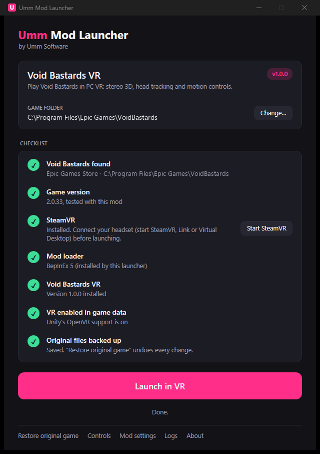
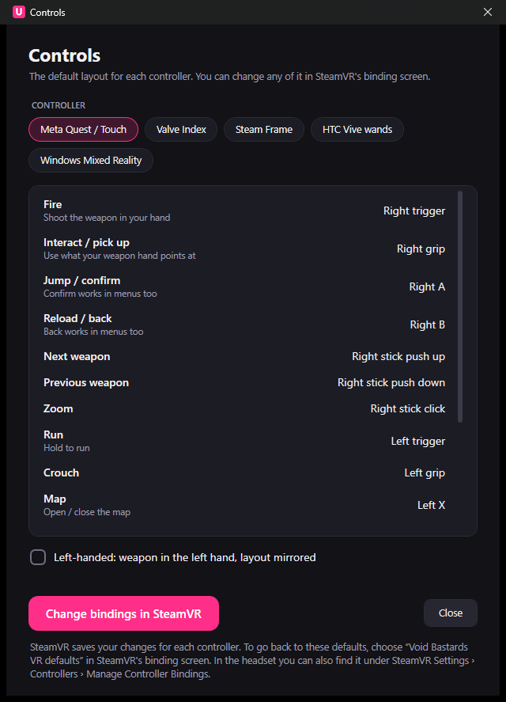

# Void Bastards VR

**Play [Void Bastards](https://store.epicgames.com/p/void-bastards) in PC VR**: an unofficial fan mod by
**Umm Software**, installed in a couple of clicks with **Umm Mod Launcher**.

Void Bastards is a comic-styled, strategy-shooter roguelike inspired by BioShock and System Shock 2.
This mod lets you play the whole game in a VR headset:

- **Stereo 3D**: the comic-book world in real depth, including the layered 3D art of the main menu.
- **Head tracking and motion controls**: aim and shoot with your hand, point and grip to interact, and move
  with the thumbstick, with snap or smooth turning.
- **A VR HUD**: the game's HUD floats in front of you; enemy names, health and damage numbers sit in the world.
- **Menus and comic pages** on a floating screen you click with a laser pointer.
- **The original art style kept intact**, including the comic ink outlines.

<!-- Screenshots: add headset captures to docs/images and reference them here. -->


> **Unofficial fan mod.** Not made, endorsed or supported by Blue Manchu or Humble Games. You need your own
> copy of Void Bastards. **No game files are included**: the launcher modifies your own copy, backs up
> everything it changes, and can restore the original game at any time.

## Compatibility

| | |
|---|---|
| **Tested** | **Epic Games Store version of Void Bastards (2.0.33)** with a **Meta Quest 3** via **Virtual Desktop** and SteamVR |
| Expected to work, not yet tested | Other SteamVR headsets; Quest via Link or Air Link; the Steam version of the game |
| Controllers | Default controls for Quest/Touch, Valve Index, Steam Frame, HTC Vive and Windows Mixed Reality. Only Quest/Touch has been tested. |

If you try an untested setup, please [open an issue](../../issues/new/choose) and let us know how it went.

## Requirements
- Windows 10 or 11 (64-bit) and a VR-ready PC
- Void Bastards (Epic Games Store; the Steam version is experimental)
- [SteamVR](https://store.steampowered.com/app/250820/SteamVR/) (free). Quest users: connect with
  Virtual Desktop, Link or Air Link.

## Install
1. Download **`VoidBastardsVR-vX.Y.Z.zip`** from [Releases](../../releases/latest) and extract it anywhere
   (not into the game folder).
2. Run **`UmmModLauncher.exe`**. It finds your game and shows a checklist of what's needed.
   - Windows SmartScreen may say "Windows protected your PC", because the app is new and unsigned. Click
     **More info → Run anyway**. Some antivirus tools also flag mod loaders; that's expected for game mods.
3. Click **Install VR mod**. Original files are backed up first.
4. Start SteamVR (or Virtual Desktop / Link), then click **Launch in VR** and put your headset on.

**Always start the game from the launcher** (or from the Epic Games Launcher), not by running
`Void Bastards.exe` directly.

**After a game update**, just click **Launch in VR** again: the launcher notices what the update undid and repairs it.

### Manual install (BepInEx yourself)
Prefer to set things up by hand? Each release also has two zips you extract straight into the game folder:
- **`VoidBastardsVR-vX.Y.Z-with-BepInEx.zip`**: the mod plus BepInEx 5.4.23.5, for a clean game.
- **`VoidBastardsVR-vX.Y.Z-plugin-only.zip`**: just the mod, for an existing BepInEx 5 (x64) install.

One step can't be done by a zip: switching on Unity's VR support in the game's own data file
(`Void Bastards_Data\globalgamemanagers`). Do it once, and again after game updates, with the launcher's
command-line mode. It installs nothing else and keeps a backup:

```
UmmModLauncher.exe --enable-vr "C:\path\to\Void Bastards"
```

Leave out the folder to find an Epic or Steam install automatically. `--disable-vr` puts the original file back.
Full instructions are in `README-MANUAL.txt` inside the zips.

## Controls (Quest / Touch, right-handed)

| Button | Action |
|---|---|
| Right trigger | Fire; laser click in menus (either trigger works) |
| Right grip | Interact / pick up (point your weapon hand at it) |
| Right A / B | Jump / reload; confirm / back in menus |
| Right stick | Turn (left/right); next / previous weapon (push up/down); zoom (click) |
| Left stick | Move |
| Left trigger / grip | Run / crouch |
| Left X / Y | Map / pause menu |
| Both grips (hold 1 s) | Recenter the view |

In the launcher, **Controls** shows the default layout for every supported controller, has a **left-handed**
option, and opens SteamVR's binding screen so you can change any button.



## Restoring the original game
Open the launcher and click **Restore original game**. Every file is put back exactly as it was; your mod
settings are kept in case you reinstall. You can also use "Verify" in the Epic Games Launcher afterwards.

## Settings
**Mod settings** in the launcher opens the settings file: HUD size and distance, snap-turn angle, aim
smoothing, render scale and more. Each setting is described in the file. Restart the game after changing it.

## Troubleshooting
- **The game starts flat (not in VR) or without the mod.** Fully quit the game and the Epic Games Launcher,
  then click **Launch in VR** again. The launcher detects this and retries once by itself.
- **"The mod loaded but VR didn't start".** Make sure SteamVR is running and your headset is connected before
  launching.
- **Something else.** Click **Logs** in the launcher and attach `LogOutput.log` (the mod's log) and
  `launcher.log` to an [issue](../../issues/new/choose). Logs can contain your folder names; edit those out if
  you prefer.

## Known limitations
- Guns are the game's original 2D sprites. 3D models may come later. Aim with laser projected from hand. 

## Privacy
The launcher doesn't send or collect anything and makes no network connections of its own. It only opens web
pages you click (store links, and SteamVR's local binding page) in your browser. Its settings and backups stay
on your PC in `%LOCALAPPDATA%\UmmSoftware`.

## Licence
Void Bastards VR and Umm Mod Launcher are **free to use but not open source**. See [LICENSE.md](LICENSE.md).
Please link to this page rather than re-uploading the files elsewhere.

Includes [BepInEx](https://github.com/BepInEx/BepInEx) (LGPL-2.1), HarmonyX and MonoMod (MIT), the OpenVR
runtime (BSD-3) and more: see [THIRD-PARTY-NOTICES.md](THIRD-PARTY-NOTICES.md).

"Void Bastards" is a trademark of its respective owners. © Umm Software.
